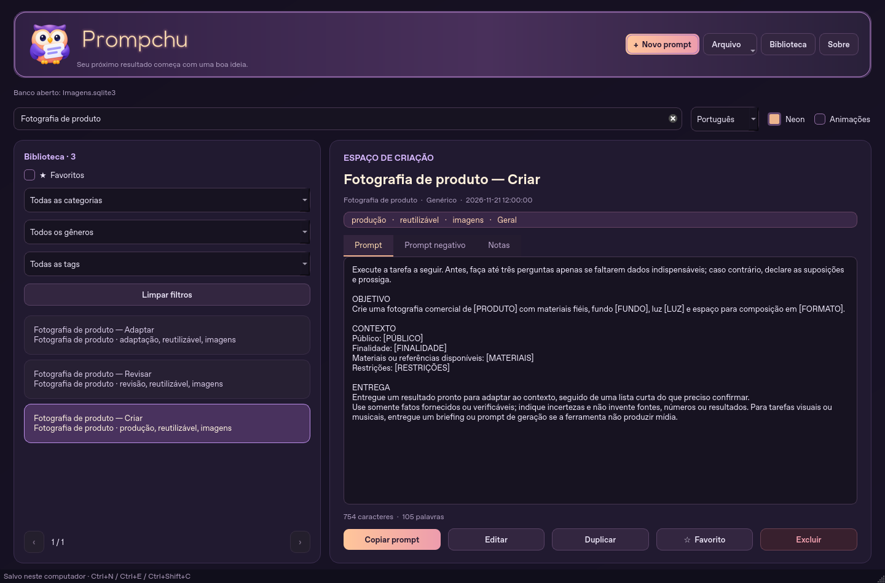
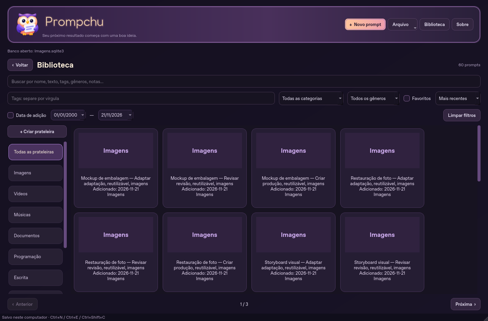

<p align="center">
  
</p>
<h1 align="center">Prompchu 🦉</h1>
<p align="center"><strong>Your ideas organized. Your best prompts always within reach.</strong></p>
<p align="center"><a href="README.md">Português</a> · <strong>English</strong></p>
<p align="center">
  <a href="https://github.com/cleitinhodev/prompchu/releases/latest">Download stable release</a> ·
  <a href="#getting-started">Getting started</a> ·
  <a href="#540-prompts-to-get-started">Example databases</a> ·
  <a href="https://www.bugzinho.com/">Website</a>
</p>

## What is Prompchu?

**Prompchu** is a desktop application for saving, organizing and reusing prompts. Instead of scattering your instructions across files, conversations and notes, keep them in local databases with names, tags, shelves and reference images.

It is useful for images, videos, writing, programming, studying and any activity where a good set of instructions can be reused. Save the version that worked, add your observations, find it through filters and copy it into your preferred tool.

Prompchu is an **organizer**: it does not execute prompts or generate AI content, and it does not require an API key. Database management works offline.

## Explore the interface

### Your prompt at the center

The main screen places your list beside the selected text. Separate **Prompt**, **Negative prompt** and **Notes** tabs keep the main instructions and supporting information organized. Copy, edit, duplicate and favorite actions are available in one click.



### A library for exploring your ideas

The **Library** fills the central area with cards, tags, dates and shelves. Combine filters, browse pages and click a card to return to the main screen with that prompt selected.



*Actual captures of version 1.3.0 in Portuguese, using the optional Images database. Cards show the default appearance for entries without thumbnails. Fonts and window details may vary by operating system. You can switch the application interface to English.*

## What's in version 1.3.0

**1.3.0 is the current stable release**, bringing together the visual Library, independent databases and custom shelves approved during testing.

| Feature | How it helps |
| --- | --- |
| Card-based Library | Browse titles, tags and dates with optional thumbnails. |
| Custom shelves | Create your own sections; they remain available even when empty. |
| Multiple databases | Separate projects, work and collections into independent files. |
| Same-window switching | Open another database without keeping two application windows open. |
| Database merging | Combine two collections into a new file while preserving both originals. |
| Individual prompt transfer | Export the selected prompt as JSON and import it into another database. |
| Full backups | Keep a copy of prompts, thumbnails and shelves. |
| Configurable appearance | Toggle neon and animations independently. |

The visual identity combines the owl mascot's colors with dark panels and glowing accents. The title uses the Fredoka font with a subtle flickering-letter effect. Motion effects can be disabled.

## What you can save

Each prompt can include:

- **Name and prompt:** the required fields for identifying and using an entry.
- **Tags and genres:** comma-separated terms for organization and search.
- **Category and model/tool:** free-form information about purpose and usage context.
- **Shelf:** the collection section where the prompt belongs.
- **Negative prompt and notes:** restrictions, extra instructions, tips and observations.
- **Favorite and thumbnail:** a way to highlight frequently used entries and attach an optional visual reference.

The application records creation and update dates. You can edit, duplicate or delete prompts, with confirmation before deletion.

## Download and launch

Visit the **[latest stable release](https://github.com/cleitinhodev/prompchu/releases/latest)** and choose your operating system's package. Executable packages already include Python.

| System | Package and launch instructions |
| --- | --- |
| 64-bit Windows 10/11 | Download the `Windows-AMD64` ZIP, extract everything and open `Prompchu/Prompchu.exe`. |
| Linux x86_64 | Download the `.tar.gz`, extract it and run `./Prompchu/Prompchu`. Built on Ubuntu 22.04; requires a graphical environment and system Qt/X11/OpenGL libraries. |
| macOS Apple Silicon | Download the `Darwin-arm64` ZIP, extract it and open `Prompchu.app`. Targets macOS 15 or later; this is not an Intel build. |

**Keep all package files together.** Do not move only the executable outside its folder. The Linux package is not an AppImage. Packages do not have an Authenticode certificate or Apple notarization. `SHA256SUMS.txt` lets you check download integrity; it is not a digital author signature.

## Getting started

1. Open the application. Use the default database or create one through **File → Create database**.
2. Click **New prompt**, enter a name and text, and choose a shelf.
3. Add tags, notes and a thumbnail if useful. Click **Save**.
4. Find your entry in the list or through **Library**.
5. Click **Copy prompt** and paste the text into your preferred tool.

Saving in the editor writes the changes to the database. Additions, deletions and favorite changes are persisted too. You do not need a separate database-save command after every operation; unconfirmed editor text still requires clicking **Save**.

### Create a shelf

In the Library, click **Create shelf** above the list on the left. Enter a name and click **Save**. The shelf becomes available in the Library and the editor's Shelf field, even before you add any prompts to it.

Names can contain up to 80 characters. Empty names and duplicates, ignoring case and accents, are rejected. Default shelves include Images, Videos, Music, Documents, Programming, Writing, Studies, Marketing and Other.

### Search and filter

Search covers names, text and metadata, ignoring case and accents. In the Library, combine text, shelf, category, genre, favorites and an added-date range. Separate tags with commas: results must contain **all** the specified tags.

Sort by creation, update date or name. The main list displays up to **100 entries per page**, and the Library up to **24 cards**. These are page sizes, not database capacity limits: search and filters query the entire collection. Performance depends on database size and your computer.

### Use thumbnails

In the editor, use **Choose thumbnail** to select a JPG or PNG. The image is resized to fit within 640 × 400 and stored inside the database; the original file does not need to stay in the same folder. Input limits are 20 MB and 40 megapixels. **Remove thumbnail** restores the default card appearance.

## Independent databases, backups and transfers

Each database is a SQLite `.sqlite3` file containing its own prompts, metadata, images and custom shelves. You might keep separate databases for work, studying and personal projects.

| File menu | Behavior |
| --- | --- |
| **Create database** | Creates and opens an empty collection in a new file. |
| **Open database** | Opens an existing collection in the same window. Pending database writes are committed before switching. |
| **Database backup** | Saves a full copy of the current collection, including thumbnails and empty shelves. |
| **Merge databases** | Selects two databases and saves their contents into a third file without replacing or deleting the originals. |
| **Import prompt** | Adds JSON entries to the open database; collections exported by older versions are also accepted. |
| **Export prompt** | Saves only the selected prompt as JSON, including metadata and its thumbnail. |

The database name appears below the header; hover over it to see the full path. The last opened database is remembered for the next launch. Switching databases clears the screen's filters and updates the available options to match the new collection.

Merging preserves dates, favorites, thumbnails and empty shelves. **Duplicate prompts are kept**: there is no automatic deduplication. Reimporting the same JSON also creates copies. Imported entries receive a new added date at import time.

**Transfer example:** select a prompt → **Export prompt** → open another database → **Import prompt**. To restore or inspect a SQLite backup, simply use **Open database**.

## 540 prompts to get started

The release includes the optional **[Prompchu-Bancos-Uteis-1.3.0.zip](https://github.com/cleitinhodev/prompchu/releases/download/v1.3.0/Prompchu-Bancos-Uteis-1.3.0.zip)** download. It contains a folder with nine independent databases and a usage guide. **The prompt collections are written in Portuguese.**

| Database | Example tasks | Entries |
| --- | --- | ---: |
| Images | Products, characters, environments, icons, prints and relief references | 60 |
| Videos | Scripts, tutorials, shot lists, narration, subtitles and clips | 60 |
| Documents | Meeting minutes, reports, procedures, briefs and presentations | 60 |
| Programming | Debugging, reviews, tests, SQL, interfaces and packaging | 60 |
| Music | Soundtracks, loops, lyrics, arrangements and soundscapes | 60 |
| Studies | Explanations, exercises, flashcards, plans and revision | 60 |
| Marketing | Descriptions, posts, pages, ads and portfolios | 60 |
| Writing | Characters, scenes, worlds, continuity and localization | 60 |
| Productivity | Planning, meetings, organization and retrospectives | 60 |
| **Total** | **20 tasks per area × 3 versions: create, review and adapt** | **540** |

Extract the ZIP and choose a `.sqlite3` file through **File → Open database**. Replace the `[BRACKETED FIELDS]` before using the text. These are reusable generic templates; review the responses produced by your chosen tool.

**Examples are not loaded or imported automatically.** They are a separate download from the application. Edits to these databases are saved normally; extract the ZIP again if you want to start over with the originals.

## Languages and shortcuts

Navigation and the editor support **Portuguese, English, Spanish, French, German, Italian, Japanese, Korean, Simplified Chinese and Russian**. Some technical messages still appear in Portuguese. Changing the interface language does not translate your prompts.

| Shortcut | Action |
| --- | --- |
| `Ctrl+N` | New prompt |
| `Ctrl+E` | Edit the selected entry |
| `Ctrl+F` | Focus search on the current screen |
| `Ctrl+Shift+C` | Copy the selected prompt |
| Double-click in the main list | Edit the selected entry |

## Data and privacy

The application stores prompts and thumbnails locally without automatically sending them to external services. The database is **not encrypted**: anyone with access to the file can read its contents using a SQLite tool.

On Windows, the default database is usually at `%APPDATA%\Bugzinho\BancoDePrompts\prompts.sqlite3`. The internal `BancoDePrompts` identifier was kept to preserve existing data from older versions. Manually created databases are stored wherever you choose; check the path shown in the application.

Make regular backups and keep a copy on another device. JSON import accepts v1 and v2; current exports use v2, which **cannot be imported by version 1.2.0**. Back up older databases before upgrading. The application adds shelf and thumbnail structures without deleting existing prompts.

Normal use does not require a connection, but installing dependencies from source requires internet access. Website, repository and donation links open in your browser. `BANCO_PROMPTS_DIR` can override the default database folder.

## Run from source

Built with **Python, PySide6 and SQLite**. Prefer 64-bit Python 3.12; the interface dependency is pinned to PySide6 6.8.3.

On Windows, `Iniciar.bat` creates the environment and installs dependencies. For manual setup:

```sh
python -m venv .venv
```

Activate it with `.venv\Scripts\activate` in the Windows command prompt or `source .venv/bin/activate` on Linux/macOS. Then run:

```sh
python -m pip install -r requirements.txt
python main.py
```

### Build a package

Run on the target operating system:

```sh
python -m pip install -r requirements-build.txt
python scripts/build_release.py
```

The script uses PyInstaller, includes application resources, checks that the executable launches and creates the package in `release/`. `Gerar-EXE.bat` is also available for Windows. Always distribute the complete package.

### Tests and example generation

```sh
python -m unittest discover -s tests -v
python tests/smoke_ui.py
python scripts/make_useful_banks.py
```

Interface tests use Qt offscreen. The example generator creates the nine databases and ZIP in `examples/` without reading or modifying the user's database. Automated tests complement manual checks on the target systems.

## Project structure

| File or folder | Responsibility |
| --- | --- |
| `main.py` | Main window, editor and user actions |
| `storage.py` / `databases.py` | Persistence, queries, database opening and merging |
| `library_view.py` | Card Library, shelves and filters |
| `thumbnails.py` | Thumbnail validation and preparation |
| `visual.py` / `wordmark.py` | Theme, neon and title animation |
| `i18n.py` | Interface translations |
| `assets/` | Icons, images and font |
| `scripts/` | Builds and optional database generation |
| `tests/` | Automated tests |
| `docs/images/` | Interface screenshots used in this README |

## Development, credits and contact

The **main** branch contains stable version 1.3.0. **legado** preserves the previous main version (1.2.0), and **teste-biblioteca** retains the history of the approved test version. The **Release desktop** workflow builds and tests natively on Windows, Ubuntu 22.04 and macOS 15; changing `VERSION` on main starts publication.

The appearance was inspired by Renemya, with a separate implementation of the effects. The Fredoka font includes its SIL Open Font License in [`assets/fonts/OFL.txt`](assets/fonts/OFL.txt). PySide6/Qt have their own licenses. The owl images were created with AI assistance. The project does not currently declare a distribution license for its code and artwork.

Found a problem or have a suggestion? Open an [Issue](https://github.com/cleitinhodev/prompchu/issues) with the version, operating system and reproduction steps. Use fictional examples and do not attach databases containing private information.

**[Website](https://www.bugzinho.com/) · [Repository](https://github.com/cleitinhodev/prompchu) · [Support the project](https://www.bugzinho.com/donate)**
