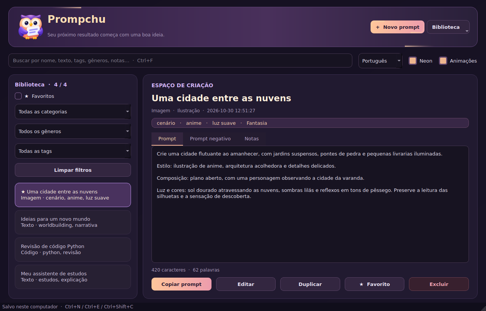

<p align="center">
  
</p>

<h1 align="center">Prompchu 🦉</h1>
<p align="center">Seu banco de prompts — local, organizado e fácil de consultar.</p>

Aplicativo desktop em **Python + PySide6**, com interface em português e armazenamento local em **SQLite**. Guarde prompts para imagens, textos, programação e outros usos com informações que ajudam a encontrá-los depois.

## Recursos

- Cadastro, edição, duplicação e exclusão com confirmação.
- Nome, tags, gêneros, categoria, modelo/ferramenta, prompt negativo e notas.
- Favoritos e cópia do prompt com um clique.
- Busca em todos os campos, sem diferenciar maiúsculas nem acentos.
- Filtros combináveis por categoria, gênero, tag e favoritos.
- Importação e exportação JSON e backup completo SQLite.
- Corujinha inteira na identidade do programa e no ícone do executável; cabeça no ícone da janela.

O Prompchu organiza seus textos; não gera conteúdo com IA nem chama APIs externas.

## Executar pelo código-fonte

Recomendado: **Python 3.12 de 64 bits**. Dependência fixada em PySide6 6.8.3; use Python 3.10–3.13 compatível com essa versão do Qt.

No Windows, extraia/clone o projeto e abra `Iniciar.bat`. Ele cria um ambiente virtual e instala as dependências na primeira execução (requer internet e Python instalado).

Ou use o terminal:

```sh
python -m venv .venv
```

Ative o ambiente:

```bat
:: Windows
.venv\Scripts\activate
```

```sh
# Linux/macOS
source .venv/bin/activate
```

Depois:

```sh
python -m pip install -r requirements.txt
python main.py
```

O código usa recursos multiplataforma do Qt. A distribuição executável tem como alvo Windows 10/11 de 64 bits; suporte em outros sistemas depende dos requisitos do Qt.

## Gerar executável no Windows

Abra `Gerar-EXE.bat` no Windows com Python instalado. A build usa PyInstaller e inclui as bibliotecas necessárias, sem exigir Python no computador que receber o resultado.

Saída: `dist/Prompchu/Prompchu.exe`. **Distribua toda a pasta `dist/Prompchu`**, mantendo `_internal` e os demais arquivos juntos.

O workflow `.github/workflows/windows-build.yml` também testa e compila a versão Windows. No GitHub, abra **Actions → Build Windows → Run workflow**. Após sucesso, baixe o artefato `Prompchu-Windows64` e extraia-o antes de abrir o EXE. Artefatos de Actions podem exigir login e têm prazo de retenção.

## Usar

1. Clique em **Novo** e preencha nome e prompt (obrigatórios).
2. Separe tags e gêneros por vírgula. Categorias e nomes de modelos são livres.
3. Use a busca e os filtros para encontrar seus registros.
4. Clique em **Copiar prompt** para usar o texto em outra ferramenta.

| Atalho | Ação |
| --- | --- |
| Ctrl+N | Novo prompt |
| Ctrl+E | Editar selecionado |
| Ctrl+F | Focar busca |
| Ctrl+Shift+C | Copiar prompt selecionado |
| Duplo clique | Editar selecionado |

## Dados, privacidade e backups

Os dados ficam no seu computador. O caminho do banco aparece na dica ao passar o mouse sobre o rodapé. O identificador interno `BancoDePrompts` foi mantido para **continuar usando os dados da versão anterior**; o nome exibido é Prompchu.

No Windows, a localização usual é `%APPDATA%\Bugzinho\BancoDePrompts\prompts.sqlite3`.

- Atualizar o código ou a build não exige apagar esse arquivo.
- Os dados **não são criptografados**.
- Use **Backup do banco** e guarde uma cópia em outro dispositivo.
- Para restaurar SQLite, feche o aplicativo e substitua o banco pela cópia de backup.
- Para levar registros a outro PC, exporte JSON e importe no destino.
- A exportação inclui **todos** os prompts, mesmo com filtros ativos.
- Importar adiciona registros e mantém os existentes; repetir a importação cria cópias.
- `BANCO_PROMPTS_DIR` permite escolher outra pasta de dados com permissão de escrita.

A instalação e a build podem usar internet para baixar pacotes. O uso do aplicativo não envia prompts a serviços externos.

## Estrutura

```text
main.py                     Aplicativo e persistência SQLite
assets/                     PNGs transparentes e ICOs da corujinha
scripts/build_windows.py    Build PyInstaller com ícone e assets
Iniciar.bat                 Execução com ambiente virtual
Gerar-EXE.bat               Build local Windows
requirements.txt           Dependência de execução
requirements-build.txt     Dependências de build
tests/                      Testes de persistência e interface
.github/workflows/          Build Windows no GitHub Actions
```

## Testes

```sh
python -m unittest discover -s tests -v
python tests/smoke_ui.py
```

O teste de interface usa a plataforma Qt `offscreen`. Os testes automatizados não substituem a conferência de abertura em Windows real.

## Identidade visual

- `assets/prompchu-corujinha.png`: mascote completo em PNG transparente.
- `assets/prompchu-corujinha.ico`: ícone do executável.
- `assets/prompchu-cabeca.png`: cabeça em PNG transparente.
- `assets/prompchu-cabeca.ico`: ícone da janela e favicon para eventual site.

Os ICOs contêm resoluções de 16 a 256 pixels. As imagens foram criadas com auxílio de IA para este projeto.

## Desenvolvimento

Esta é a base inicial do Prompchu, versão **1.2.0**. Sugestões e problemas podem ser registrados nas Issues. Não envie bancos ou exports contendo informações privadas.

PySide6/Qt são dependências de terceiros com licenças próprias: consulte a [documentação do Qt for Python](https://doc.qt.io/qtforpython-6/). Este projeto ainda não declara uma licença de distribuição para seu código e arte.

## Owl Studio — 1.2.0

Owl Studio agora é a versão principal na `main`. A branch `testes/owl-neon` fica disponível para experimentação.



- Cabeçalho em degradê, painéis roxos, ações em coral e detalhes dourados da corujinha.
- Biblioteca lateral com filtros combináveis, favoritos, contador de resultados e botão para limpar filtros.
- Leitura com abas separadas para prompt, negativo e notas; contagem de caracteres e palavras.
- Ações indisponíveis ficam desativadas quando não há seleção; textos do usuário são exibidos literalmente.
- Editor com rolagem para manter Salvar e Cancelar acessíveis em telas menores.
- Menu Biblioteca reúne importação, exportação e backup.
- Neon desenhado nas bordas com relógio compartilhado a aproximadamente 30 fps. Pausa quando a janela está escondida, minimizada ou sem foco.
- Neon e animações independentes: desligar movimento mantém um contorno estático; desligar neon remove os efeitos.
- Preferências, tamanho da janela e divisão dos painéis persistentes. A troca de idioma preserva busca, filtros, seleção e aba.
- Dez idiomas para navegação e editor: português, inglês, espanhol, francês, alemão, italiano, japonês, coreano, chinês simplificado e russo. Mensagens técnicas e parte dos diálogos de importação/backup ainda usam português nesta prévia.

O Renemya serviu de referência de aparência e comportamento; a implementação dos efeitos nesta versão é própria. Banco SQLite e formato JSON foram preservados, sem migração destrutiva.

Validação: testes de persistência, validação e rollback; testes de filtros, cópia literal, abas, estados vazios, controles de efeitos e abertura nos dez idiomas. Capturas e verificações de interface usam Qt offscreen; não substituem teste manual do executável em Windows.

## Releases Windows, Linux e macOS

Baixe os pacotes em [Releases](https://github.com/cleitinhodev/prompchu/releases). Consulte as instruções e os requisitos de cada sistema nas notas do release. O workflow `Release desktop` compila nativamente em Windows, Ubuntu 22.04 e macOS 14 (Apple Silicon), testa cada pacote e só publica quando os três terminam com sucesso. Atualizar `VERSION` na `main` inicia uma nova publicação.

Cada release inclui `SHA256SUMS.txt`: os hashes permitem comparar a integridade dos arquivos baixados com os publicados. Eles não substituem assinatura de autor; esta versão não tem certificado Authenticode nem notarização Apple.

O título usa a fonte Fredoka, distribuída com sua licença SIL Open Font License em `assets/fonts/OFL.txt` ([origem](https://github.com/google/fonts/tree/main/ofl/fredoka)). Apenas uma letra por vez apresenta falhas suaves de luminosidade, com intervalos aleatórios. O efeito pausa com a janela inativa e respeita os controles Neon e Animações.

## Biblioteca beta — 1.3.0-beta.1

Experimento na branch `teste-biblioteca`, sem alteração da main. O menu antigo **Biblioteca** passa a se chamar **Arquivo**. O novo botão **Biblioteca** abre a grade de cartões, com miniaturas JPG/PNG locais, datas, tags, prateleiras e filtros combináveis.

A tela inicial carrega até 100 resumos por página e a biblioteca até 24 cartões. Busca e filtros operam no SQLite sobre a coleção inteira. Apenas o texto selecionado é carregado integralmente; a busca por conteúdo ainda precisa examinar textos no SQLite e não promete tempo constante para coleções enormes.

Use **Novo/Editar → Prateleira** para classificar e **Escolher miniatura** para adicionar uma imagem. Limites: 20 MB e 40 megapixels por imagem, reduzida para até 640 × 400 e salva dentro do banco. **Remover miniatura** volta ao cartão padrão. A migração reconhece categorias comuns dos registros antigos; registros sem prateleira aparecem em Outros.

Use **Arquivo → Abrir demonstração** para testar 54 exemplos em uma janela e banco temporários separados. `assets/demo-prompts.json` é importável e `scripts/make_examples.py` gera `examples/prompts-demo.sqlite3`, sem tocar no banco do usuário. Ambos são anexados ao pré-release. Os exemplos não são adicionados automaticamente à coleção pessoal.

**Backup do banco** inclui miniaturas. JSON v2 inclui prateleiras e imagens; a beta aceita v1/v2, mas a versão estável 1.2.0 não importa v2. Faça backup antes de experimentar com seus dados.
