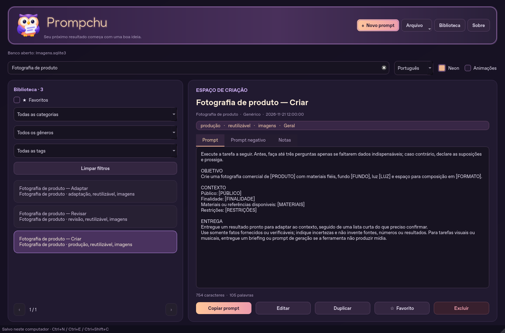
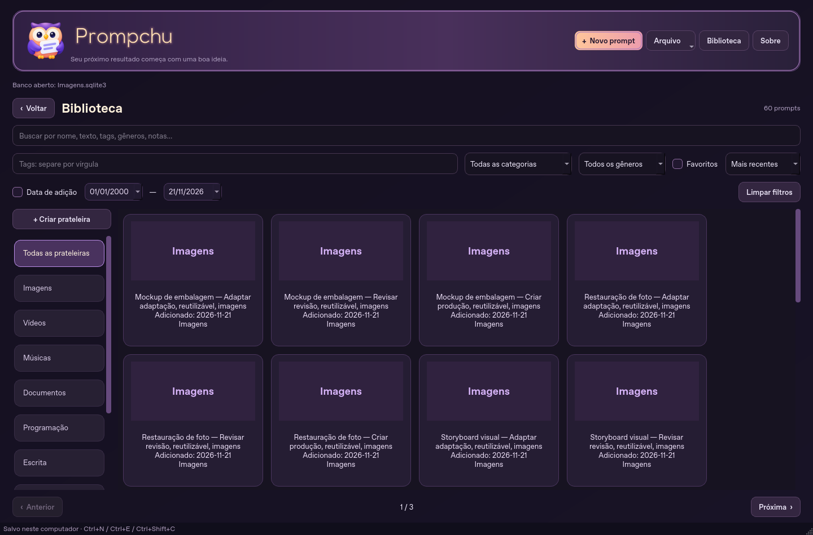

<p align="center">
  
</p>
<h1 align="center">Prompchu 🦉</h1>
<p align="center"><strong>Suas ideias organizadas. Seus melhores prompts sempre por perto.</strong></p>
<p align="center"><strong>Português</strong> · <a href="README.en.md">English</a></p>
<p align="center">
  <a href="https://github.com/cleitinhodev/prompchu/releases/latest">Baixar versão estável</a> ·
  <a href="#primeiros-passos">Primeiros passos</a> ·
  <a href="#540-prompts-para-começar">Bancos de exemplos</a> ·
  <a href="https://www.bugzinho.com/">Site</a>
</p>

## O que é o Prompchu?

O **Prompchu** é um aplicativo desktop para guardar, organizar e reutilizar prompts. Em vez de deixar seus textos espalhados entre arquivos, conversas e blocos de notas, você pode reunir tudo em bancos de dados locais, com nomes, tags, prateleiras e imagens de referência.

Ele serve para quem trabalha com imagens, vídeos, escrita, programação, estudos ou qualquer atividade em que um bom texto de instrução possa ser usado novamente. Salve a versão que funcionou, registre observações, encontre-a pelos filtros e copie o prompt para a ferramenta que você utiliza.

O programa é um **organizador**: não executa prompts, não gera conteúdo com IA e não exige uma chave de API. O gerenciamento dos bancos funciona offline.

## Conheça a interface

### Seu prompt em destaque

Na tela inicial, a lista fica ao lado do texto selecionado. As abas **Prompt**, **Prompt negativo** e **Notas** separam o conteúdo principal das orientações complementares. Ações como copiar, editar, duplicar e marcar como favorito ficam ao alcance de um clique.



### Uma biblioteca para explorar suas ideias

A **Biblioteca** ocupa a área central com cartões, tags, datas e prateleiras. Combine os filtros, navegue pelas páginas e clique em um cartão para voltar à tela inicial com o prompt aberto.



*Capturas reais da interface 1.3.0 em português, usando o banco opcional de Imagens. Os cartões mostram a aparência padrão de registros sem miniatura. Fontes e detalhes de janela podem variar conforme o sistema.*

## O que há na versão 1.3.0

A **1.3.0 é a versão estável atual** e reúne a Biblioteca visual, bancos independentes e prateleiras personalizadas aprovados durante os testes.

| Recurso | Como ajuda no dia a dia |
| --- | --- |
| Biblioteca em cartões | Explore títulos, tags e datas, com miniaturas opcionais. |
| Prateleiras personalizadas | Crie suas próprias divisões; elas continuam disponíveis mesmo vazias. |
| Vários bancos | Separe projetos, trabalhos ou coleções em arquivos independentes. |
| Troca na mesma janela | Abra outro banco sem manter duas janelas do programa. |
| União de bancos | Reúna duas coleções em um novo arquivo, preservando os originais. |
| Transferência de um prompt | Exporte o selecionado em JSON e importe em outro banco. |
| Backup completo | Guarde uma cópia dos prompts, miniaturas e prateleiras. |
| Aparência configurável | Ligue ou desligue neon e animações independentemente. |

A identidade visual combina os tons da corujinha com painéis escuros e detalhes luminosos. O título usa a fonte Fredoka e um efeito de falhas de luminosidade nas letras. Os efeitos de movimento podem ser desligados.

## O que você pode guardar

Cada prompt pode conter:

- **Nome e prompt:** os campos obrigatórios para identificar e usar o registro.
- **Tags e gêneros:** termos separados por vírgulas para facilitar a organização e a busca.
- **Categoria e modelo/ferramenta:** informações livres sobre a finalidade e o contexto de uso.
- **Prateleira:** a divisão da coleção em que o prompt será encontrado.
- **Prompt negativo e notas:** restrições, instruções adicionais, dicas e observações.
- **Favorito e miniatura:** destaque para os registros mais usados e uma referência visual opcional.

As datas de criação e atualização são registradas pelo aplicativo. Você pode editar, duplicar ou excluir prompts, com confirmação antes da exclusão.

## Baixar e abrir

Acesse o **[release estável mais recente](https://github.com/cleitinhodev/prompchu/releases/latest)** e escolha o pacote do seu sistema. Os executáveis já incluem Python.

| Sistema | Pacote e execução |
| --- | --- |
| Windows 10/11 de 64 bits | Baixe o ZIP `Windows-AMD64`, extraia tudo e abra `Prompchu/Prompchu.exe`. |
| Linux x86_64 | Baixe o `.tar.gz`, extraia e execute `./Prompchu/Prompchu`. A build usa Ubuntu 22.04 e requer ambiente gráfico e bibliotecas Qt/X11/OpenGL. |
| macOS Apple Silicon | Baixe o ZIP `Darwin-arm64`, extraia e abra `Prompchu.app`. Alvo macOS 15 ou superior; não é uma build Intel. |

**Mantenha todos os arquivos do pacote juntos.** Não mova apenas o executável para fora da pasta. O pacote Linux não é AppImage. Os pacotes não possuem certificado Authenticode nem notarização Apple. O arquivo `SHA256SUMS.txt` permite verificar a integridade dos downloads; ele não substitui uma assinatura digital de autoria.

## Primeiros passos

1. Abra o programa. Você pode usar o banco padrão ou criar um em **Arquivo → Criar banco**.
2. Clique em **Novo prompt**, preencha nome e texto e escolha uma prateleira.
3. Adicione tags, notas e uma miniatura se forem úteis. Clique em **Salvar**.
4. Encontre o registro pela lista ou pelo botão **Biblioteca**.
5. Clique em **Copiar prompt** e cole o texto na ferramenta desejada.

Salvar no editor grava a alteração no banco. Adições, exclusões e mudanças de favorito também são persistidas. Não é necessário salvar o banco manualmente após cada operação; o texto ainda não confirmado no editor depende do botão **Salvar**.

### Criar uma prateleira

Na Biblioteca, clique em **Criar prateleira**, acima da lista à esquerda. Digite um nome e clique em **Salvar**. Ela passa a aparecer na Biblioteca e no campo Prateleira do editor, mesmo que ainda não tenha prompts.

Os nomes podem ter até 80 caracteres. Nomes vazios ou equivalentes aos já existentes, desconsiderando maiúsculas e acentos, são recusados. As prateleiras padrão incluem Imagens, Vídeos, Músicas, Documentos, Programação, Escrita, Estudos, Marketing e Outros.

### Buscar e filtrar

A busca considera nome, texto e metadados, sem diferenciar maiúsculas ou acentos. Na Biblioteca, combine texto, prateleira, categoria, gênero, favoritos e intervalo de datas de adição. No campo de tags, separe os termos por vírgula: o resultado precisa conter **todas** as tags informadas.

Você pode ordenar por criação, atualização ou nome. A lista inicial mostra até **100 registros por página**, e a Biblioteca até **24 cartões**. Esses números limitam a página exibida, não a quantidade total guardada: a busca e os filtros consultam a coleção inteira. A velocidade depende do tamanho do banco e do computador.

### Usar miniaturas

No editor, use **Escolher miniatura** para selecionar JPG ou PNG. A imagem é reduzida para até 640 × 400 e armazenada dentro do banco; o arquivo original não precisa permanecer na mesma pasta. A entrada aceita até 20 MB e 40 megapixels. **Remover miniatura** devolve ao cartão sua aparência padrão.

## Bancos independentes, backups e transferência

Cada banco é um arquivo SQLite `.sqlite3`, com seus próprios prompts, metadados, imagens e prateleiras personalizadas. Você pode ter um para trabalho, outro para estudos e outro para projetos pessoais.

| Menu Arquivo | Funcionamento |
| --- | --- |
| **Criar banco** | Cria e abre uma coleção vazia em um arquivo novo. |
| **Abrir banco** | Abre uma coleção existente na mesma janela. As gravações pendentes do banco anterior são confirmadas antes da troca. |
| **Backup do banco** | Salva uma cópia completa da coleção atual, incluindo miniaturas e prateleiras vazias. |
| **Juntar bancos** | Seleciona dois bancos e salva o conteúdo em um terceiro arquivo, sem substituir ou excluir os originais. |
| **Importar prompt** | Adiciona os registros de um JSON ao banco aberto; também aceita coleções de versões anteriores. |
| **Exportar prompt** | Salva somente o prompt selecionado em JSON, com metadados e miniatura. |

O nome do banco aparece abaixo do cabeçalho; passe o mouse para consultar o caminho completo. O último banco aberto é lembrado na próxima execução. Ao trocar de banco, os filtros da tela são limpos e as opções passam a refletir a coleção aberta.

A união preserva datas, favoritos, miniaturas e prateleiras vazias. **Prompts repetidos são mantidos**: não há deduplicação automática. Importar o mesmo JSON novamente também cria cópias. Na importação, a data de adição passa a ser a data em que o registro foi importado.

**Exemplo de transferência:** selecione um prompt → **Exportar prompt** → abra outro banco → **Importar prompt**. Para restaurar ou consultar um backup SQLite, basta usar **Abrir banco**.

## 540 prompts para começar

O release inclui o download opcional **[Prompchu-Bancos-Uteis-1.3.0.zip](https://github.com/cleitinhodev/prompchu/releases/download/v1.3.0/Prompchu-Bancos-Uteis-1.3.0.zip)**. Ele contém uma pasta com nove bancos independentes e um guia de uso.

| Banco | Exemplos de tarefas | Registros |
| --- | --- | ---: |
| Imagens | Produtos, personagens, cenários, ícones, estampas e referências de relevo | 60 |
| Vídeos | Roteiros, tutoriais, planos, narração, legendas e cortes | 60 |
| Documentos | Atas, relatórios, procedimentos, briefings e apresentações | 60 |
| Programação | Depuração, revisão, testes, SQL, interfaces e empacotamento | 60 |
| Músicas | Trilhas, loops, letras, arranjos e paisagens sonoras | 60 |
| Estudos | Explicações, exercícios, flashcards, planos e revisão | 60 |
| Marketing | Descrições, posts, páginas, anúncios e portfólio | 60 |
| Escrita | Personagens, cenas, mundos, continuidade e localização | 60 |
| Produtividade | Planejamento, reuniões, organização e retrospectivas | 60 |
| **Total** | **20 tarefas por área × 3 versões: criar, revisar e adaptar** | **540** |

Extraia o ZIP e escolha um `.sqlite3` em **Arquivo → Abrir banco**. Substitua os campos `[ENTRE COLCHETES]` antes de usar o texto. São modelos genéricos reutilizáveis; revise as respostas da ferramenta escolhida.

**Os exemplos não são carregados nem importados automaticamente.** São um download separado do aplicativo. As edições feitas nesses bancos são salvas normalmente; extraia novamente o ZIP se quiser recomeçar com os originais.

## Idiomas e atalhos

A navegação e o editor oferecem **português, inglês, espanhol, francês, alemão, italiano, japonês, coreano, chinês simplificado e russo**. Alguns avisos técnicos ainda aparecem em português. Mudar o idioma da interface não traduz seus prompts.

| Atalho | Ação |
| --- | --- |
| `Ctrl+N` | Novo prompt |
| `Ctrl+E` | Editar o selecionado |
| `Ctrl+F` | Focar a busca da tela atual |
| `Ctrl+Shift+C` | Copiar o prompt selecionado |
| Duplo clique na lista inicial | Editar o selecionado |

## Dados e privacidade

O aplicativo armazena prompts e miniaturas localmente, sem enviá-los automaticamente a serviços externos. O banco **não é criptografado**: quem tiver acesso ao arquivo poderá ler seu conteúdo com uma ferramenta SQLite.

No Windows, o banco padrão costuma ficar em `%APPDATA%\Bugzinho\BancoDePrompts\prompts.sqlite3`. O identificador interno `BancoDePrompts` foi mantido para preservar dados de versões anteriores. Bancos criados manualmente ficam no local escolhido pelo usuário; consulte o caminho exibido no programa.

Faça backups regulares e guarde uma cópia em outro dispositivo. A importação aceita JSON v1 e v2; a exportação atual usa v2, que **não pode ser importado pela versão 1.2.0**. Faça backup antes de atualizar bancos antigos. O aplicativo adiciona as estruturas de prateleiras e miniaturas sem apagar prompts existentes.

O uso normal não depende de conexão, mas instalar dependências pelo código-fonte exige acesso à internet. Abrir os links do site, repositório ou doações usa o navegador. `BANCO_PROMPTS_DIR` permite definir a pasta do banco padrão.

## Executar pelo código-fonte

Tecnologias: **Python, PySide6 e SQLite**. Use preferencialmente Python 3.12 de 64 bits; a dependência de interface está fixada em PySide6 6.8.3.

No Windows, `Iniciar.bat` cria o ambiente e instala as dependências. Para configurar manualmente:

```sh
python -m venv .venv
```

Ative com `.venv\Scripts\activate` no terminal do Windows ou `source .venv/bin/activate` no Linux/macOS. Em seguida:

```sh
python -m pip install -r requirements.txt
python main.py
```

### Gerar uma build

Execute no sistema de destino:

```sh
python -m pip install -r requirements-build.txt
python scripts/build_release.py
```

O script usa PyInstaller, inclui os recursos do aplicativo, verifica a abertura do executável e gera o pacote em `release/`. `Gerar-EXE.bat` também está disponível para Windows. Distribua sempre o pacote completo.

### Testes e geração dos exemplos

```sh
python -m unittest discover -s tests -v
python tests/smoke_ui.py
python scripts/make_useful_banks.py
```

Os testes de interface usam Qt offscreen. O gerador de exemplos cria os nove bancos e o ZIP em `examples/`, sem ler ou modificar o banco do usuário. Os testes automatizados complementam a validação manual nos sistemas de destino.

## Estrutura do projeto

| Arquivo ou pasta | Responsabilidade |
| --- | --- |
| `main.py` | Janela principal, editor e ações do usuário |
| `storage.py` / `databases.py` | Persistência, consultas, abertura e união de bancos |
| `library_view.py` | Biblioteca em cartões, prateleiras e filtros |
| `thumbnails.py` | Validação e preparação das miniaturas |
| `visual.py` / `wordmark.py` | Tema, neon e animação do título |
| `i18n.py` | Traduções da interface |
| `assets/` | Ícones, imagens e fonte |
| `scripts/` | Builds e geração de bancos opcionais |
| `tests/` | Testes automatizados |
| `docs/images/` | Capturas da interface usadas neste README |

## Desenvolvimento, créditos e contato

A branch **main** contém a versão estável 1.3.0. A **legado** preserva a main anterior (1.2.0), e **teste-biblioteca** mantém o histórico da versão de testes aprovada. O workflow **Release desktop** compila e testa nativamente em Windows, Ubuntu 22.04 e macOS 15; uma alteração em `VERSION` na main inicia a publicação.

A aparência teve o Renemya como referência, com implementação própria dos efeitos. A fonte Fredoka acompanha a licença SIL Open Font License em [`assets/fonts/OFL.txt`](assets/fonts/OFL.txt). PySide6/Qt possuem licenças próprias. As imagens da corujinha foram criadas com auxílio de IA. O projeto ainda não declara uma licença de distribuição para seu código e arte.

Encontrou um problema ou tem uma sugestão? Abra uma [Issue](https://github.com/cleitinhodev/prompchu/issues), indicando a versão, o sistema e os passos para reproduzir. Use exemplos fictícios e não anexe bancos com informações privadas.

**[Site](https://www.bugzinho.com/) · [Repositório](https://github.com/cleitinhodev/prompchu) · [Apoiar o projeto](https://www.bugzinho.com/donate)**
